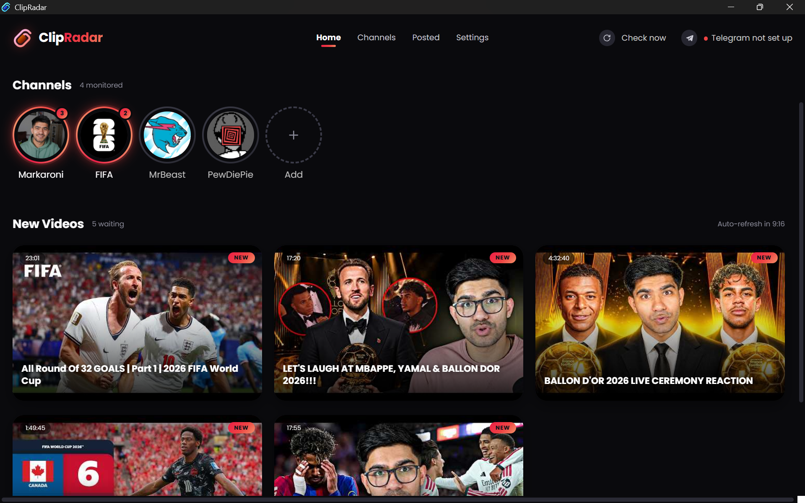
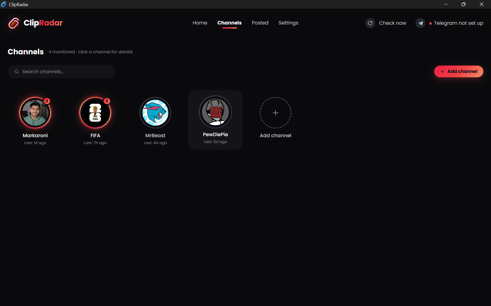
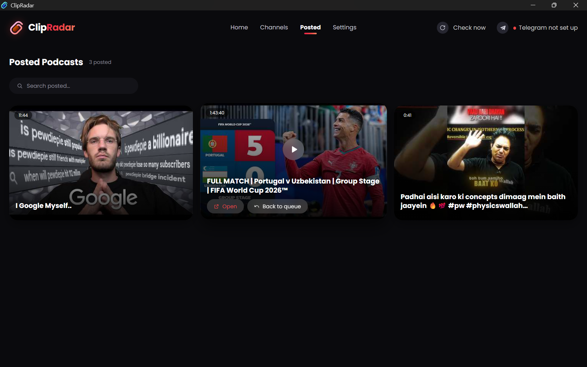
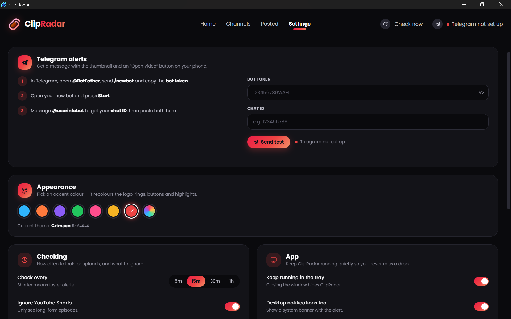

# ClipRadar

ClipRadar is a Windows desktop app (built with Electron) that watches the YouTube channels you pick and tells you the moment a new long-form video is uploaded – on your phone through Telegram and, optionally, with a desktop notification.



## Features

- **Channel watch list** – add channels by link, `@handle` or channel ID. You can paste many at once (up to 100 lines); duplicates are skipped and lines that fail stay in the box.
- **New Videos queue** (Home) – new uploads wait here until you open, dismiss or mark them as posted. The **Posted** page keeps your history and lets you send a video back to the queue.
- **Telegram alerts** – a message with the thumbnail, title, length and an "Open video" button. If Telegram is unreachable, recent alerts are retried on later checks.
- **Desktop notifications** and a **tray icon** with a waiting-count (close the window and it keeps running in the tray).
- **Filters** – ignore YouTube Shorts, wait for live streams to finish, minimum video length (0–60 min), and per-channel keyword filters.
- **Per-channel options** – mark a channel as Priority or Pause it.
- **Check interval** – 5 min, 15 min, 30 min, 1 h or a custom value; a check also runs shortly after the PC wakes from sleep.
- **Appearance** – choose an accent colour.
- **Start when I log in** (installed app only) – starts hidden in the tray.

| Channels | Posted | Settings |
| --- | --- | --- |
|  |  |  |

## How it works

No YouTube API key is needed. ClipRadar reads each channel's public YouTube RSS feed and looks at the video page for its length and live status. Telegram messages are sent through the Telegram Bot API using **your own bot**. See [docs/architecture.md](docs/architecture.md).

## Requirements

- Windows 10/11 (x64) – the packaging is set up for Windows. The source may also start on other systems with `npm start`, but that is not tested.
- [Node.js](https://nodejs.org) 20 or newer (includes npm)
- Internet access

## Run from source

```powershell
npm install
npm start
```

## Set up Telegram alerts

1. In Telegram, open **@BotFather**, send `/newbot` and copy the **bot token**.
2. Open your new bot and press **Start**.
3. Message **@userinfobot** to get your **chat ID**.
4. In ClipRadar open **Settings → Telegram alerts**, paste both values and press **Send test**.

No keys are included in this repository. Your token and chat ID are saved on your computer (see *Your data* below).

## Build the Windows installer

```powershell
npm install
npm run dist:win
```

Result: `dist\ClipRadar-Setup-1.1.0.exe`. `npm run pack:win` builds an unpacked app in `dist\win-unpacked\` for quick testing. The installer is unsigned, so Windows SmartScreen will warn on first run – see [docs/signing.md](docs/signing.md). More help: [docs/troubleshooting.md](docs/troubleshooting.md).

> The Windows build has **not** been run by the person who prepared this repository. Run it on Windows and report any problem.

## Your data

Channels, the queue, settings and the Telegram bot token/chat ID are saved as plain JSON in `%APPDATA%\clipradar\clipradar-data.json` (with a `.bak` backup). The bot token is **not encrypted**, so don't share that file. Uninstalling does not delete it.

## Project layout

```
src/main/       Electron main process (window, tray, poller, YouTube + Telegram, storage)
src/renderer/   UI (HTML/CSS/JS) and bundled Poppins fonts
assets/         App icon (icon.ico, icon.png) and tray icon
docs/           Architecture, signing, troubleshooting, screenshots
```

## Licence and credits

- The project licence has **not been chosen yet** – no `LICENSE` file is included, so by default nobody else may reuse the code. (`package.json` currently says `MIT`; decide which licence you want and add a matching `LICENSE` file before publishing, or change that field.)
- Poppins font: SIL Open Font License 1.1 – see `src/renderer/fonts/OFL.txt`.
- Confirm you have the right to redistribute the logo/icon files (`assets/`, `src/renderer/logo.png`).
- ClipRadar is not affiliated with YouTube or Telegram.
